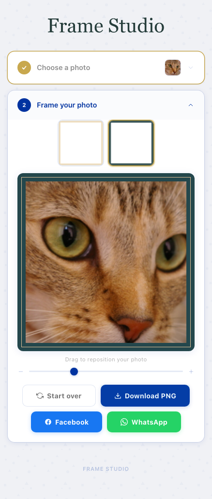

# Frame Studio · Profile photo frames

Pick a photo, position it under a frame and save a square profile picture. The two-step editor runs in the browser. Your photo stays on your device while you edit and download it.

<a href="docs/editor.png"></a>

[Open the PNG downloaded from this preview](docs/framed-photo.png)

## Run the original editor

With Python 3 installed, run these commands, then open [the editor on this computer](http://localhost:18796).

```sh
git clone https://github.com/Dror-Bengal/frame-studio.git
cd frame-studio
python3 -m http.server 18796 --bind 127.0.0.1 --directory editor
```

Alternatively, run `docker compose up -d --build` in the repository root and open the same address.

1. Click **Choose or drop a photo**. You can try the included [sample photo](editor/example/chelsea.png).
2. Select **Ivory** or **Teal**. Drag the photo and adjust the zoom. Switching frames keeps the crop.
3. Click **Download PNG**. The browser saves the displayed composition as **framed-photo.png**, at **833 × 833 pixels**.

The portfolio edition uses the original upload panel, frame selector, crop canvas and export controls. Its English labels, logo and frame artwork are neutral. The Facebook and WhatsApp buttons open the device share sheet when file sharing is available. Otherwise they save the PNG for manual attachment.

## Check the export

With the editor running, run these commands from the root:

```sh
python3 -m venv .venv
. .venv/bin/activate
python -m pip install -r tests/requirements.txt
python -m playwright install chromium webkit
python tests/check_original.py
BROWSER_ENGINE=webkit python tests/check_original.py --mobile
```

Each run uploads the example through the file chooser and downloads both frames. It opens the saved files, checks their size and border colors, compares the photo pixels against an independently cropped source, and compares each complete PNG to the canvas. It also checks that zoom survives a frame change and that an invalid upload can be replaced. Add `--capture ./captures` to save the screenshot and both downloaded files.

The repository also includes the earlier self-contained editor for direct offline use. [Single-file edition and its tests](docs/single-file-editor.md)

The sample photograph of Chelsea is by Stefan van der Walt and is released under CC0. [Photo credit and source](editor/example/CREDIT.txt)

## License

Nayto’s code is distributed under the [MIT License](LICENSE). Third-party software and media retain their respective terms.
